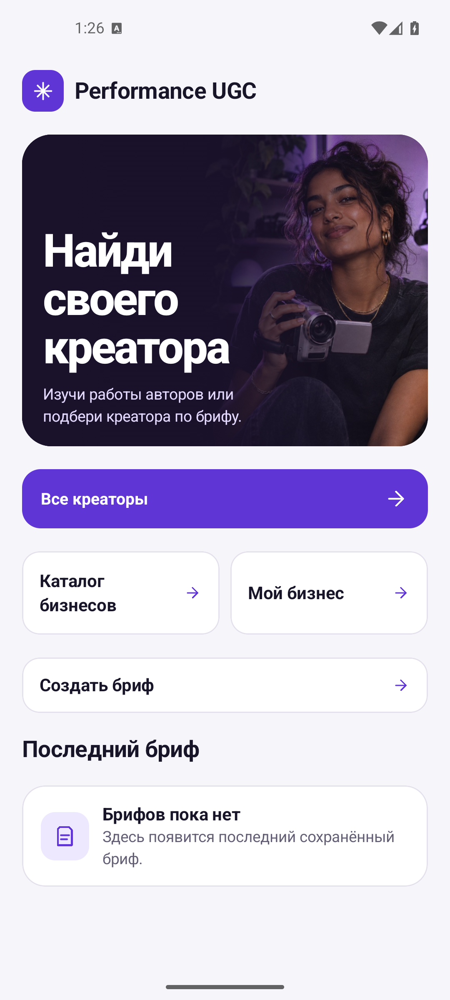
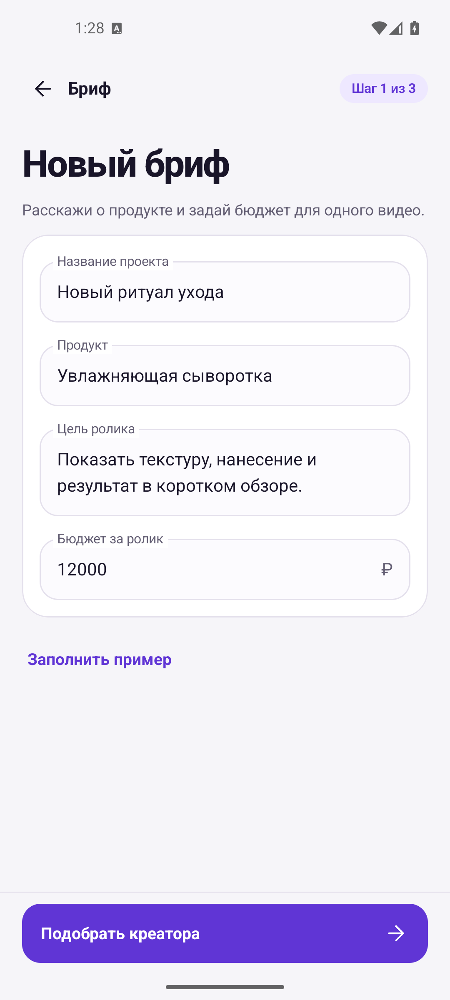
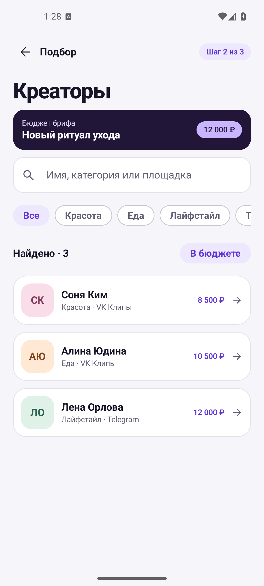
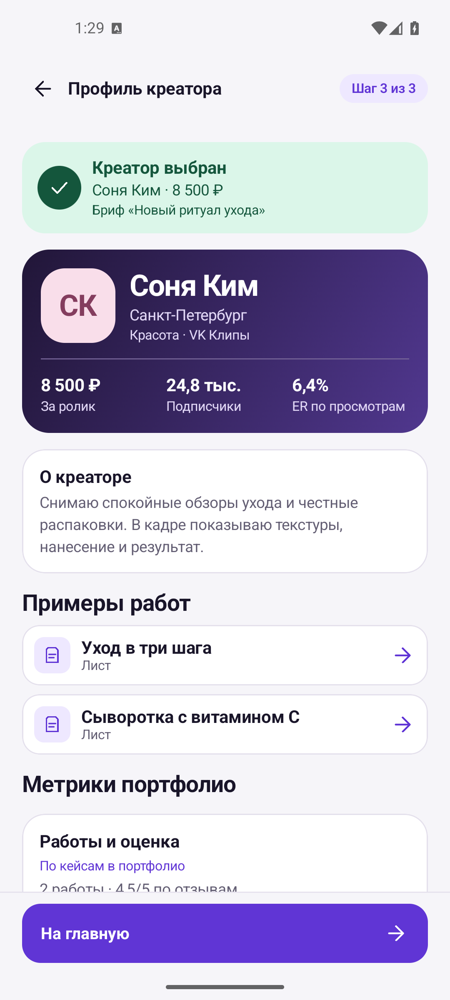
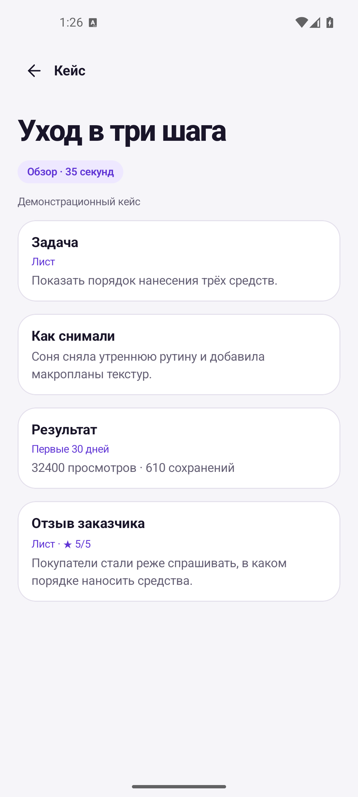
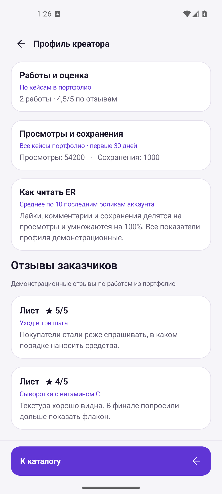
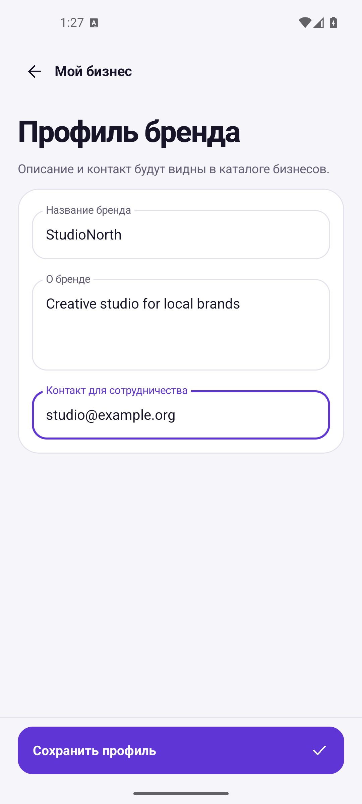
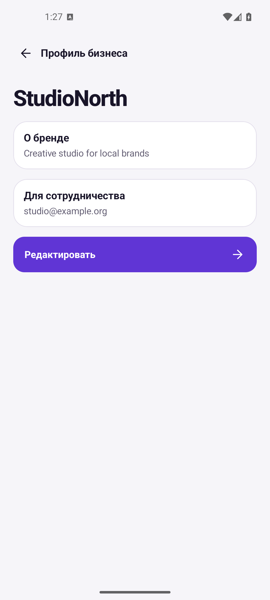

# Performance UGC · ЛР №3

Android-приложение для подготовки брифа и выбора UGC-креатора. Бренд задаёт параметры видео, подбирает автора по бюджету и сохраняет выбор.

## Как запустить

Откройте папку с этим README в Android Studio. Текущая конфигурация Gradle выбирает JDK 25 через `gradle/gradle-daemon-jvm.properties`. Для компиляции нужен Android SDK Platform 36. Первая синхронизация Gradle загружает зависимости. После синхронизации выберите конфигурацию `app` и Android-устройство с API 24 или выше.

В PowerShell из корня проекта:

```powershell
.\gradlew.bat :app:assembleDebug :app:testDebugUnitTest
```

На macOS/Linux:

```sh
sh ./gradlew :app:assembleDebug :app:testDebugUnitTest
```

APK появляется в `app/build/outputs/apk/debug/app-debug.apk`. Приложение работает офлайн, сервер и настройка портов не требуются.

## Структура проекта

Исходники приложения находятся в `app/src/main/java/ru/performanceugc/lr3`.

| Пакет | Что внутри |
| --- | --- |
| `ui` | Экраны и ViewModel по сценариям: главная, бриф, каталог, профиль креатора и кабинет бизнеса. Общая тема и компоненты находятся в `ui.common`. |
| `navigation` | Маршруты Navigation Compose и аргументы переходов. |
| `domain` | Предметные модели в `domain.model`, проверка брифа и фильтрация креаторов. |
| `data` и `di` | Интерфейс репозитория, локальная реализация с демоданными и модуль Hilt. |

Модульные тесты находятся в `app/src/test`, скриншоты — в `docs/screenshots`.

## Знакомство с биржей

С главной откройте «Все креаторы». Доступны все четыре автора, поиск и фильтры по категории. В профиле выберите работу, чтобы увидеть задачу, ход съёмки, результаты и отзыв. Восемь кейсов и восемь отзывов вымышлены. Просмотры и сохранения указаны за первые 30 дней, сводка профиля суммирует показатели кейсов. Средняя оценка рассчитывается по отзывам этих кейсов. ER — среднее отношение суммы лайков, комментариев и сохранений к просмотрам по 10 последним роликам аккаунта, в процентах.

В «Каталоге бизнесов» доступны публичные карточки четырёх демобрендов. В разделе «Мой бизнес» сохраните название, описание и контакт. Собственная карточка появится в этом же каталоге и будет доступна после перезапуска. Редактировать её можно с главной или из самой карточки. Прототип работает на одном устройстве.

## Подбор по брифу

1. На главной нажмите «Создать бриф», затем «Заполнить пример». Бриф о сыворотке предлагает бюджет 12 000 ₽ за ролик.
2. Нажмите «Подобрать креатора». По умолчанию видны три из четырёх профилей, включая автора с ценой ровно 12 000 ₽. Категория «Техника» при включённом фильтре «В бюджете» показывает пустое состояние. Из него можно сбросить фильтры.
3. Откройте карточку Сони Ким и нажмите «Выбрать креатора». В профиле появится подтверждение с именем, ценой и названием брифа. Системная кнопка «Назад» возвращает в подбор, где виден выбранный автор.
4. Для проверки валидации сделайте попытку отправить пустой бриф. Для проверки состояния введите текст или поменяйте фильтр и поверните устройство. После перезапуска приложения последний бриф открывается с главной.

Каталог содержит четыре вымышленных профиля с ценой, категорией, площадкой и примерами работ. Бриф и выбранный автор хранятся в приватных настройках приложения. Экран профиля с подтверждением завершает сценарий.

## Навигация

| Route | Аргумент | Экран |
| --- | --- | --- |
| `home` | — | Главная |
| `brief` | — | Создание брифа |
| `creators?briefId={briefId}` | Необязательный `briefId` | Все креаторы или подбор по бюджету |
| `creator/{creatorId}?briefId={briefId}` | `creatorId`, необязательный `briefId` | Профиль и выбор для брифа |
| `work/{creatorId}/{projectId}` | `creatorId`, `projectId` | Кейс |
| `businesses` | — | Каталог бизнесов |
| `business/{id}` | `id` | Карточка бизнеса |
| `account` | — | Редактирование своего профиля |

## Реализация

- Navigation Compose передаёт идентификаторы. Системный возврат из профиля оставляет фильтры каталога, а кнопка «На главную» сворачивает сценарий до стартового экрана.
- Hilt предоставляет репозиторий и ViewModel. Compose читает состояние через `collectAsStateWithLifecycle()`. `SavedStateHandle` хранит введённый текст и фильтры.
- Каждый класс, интерфейс и объект объявлен в отдельном одноимённом Kotlin-файле. Compose-функции сгруппированы по экранам.
- Валидация брифа, фильтрация и проверка бюджета находятся в Kotlin-коде без Android-зависимостей. Тесты проверяют валидацию, граничное значение бюджета и пересечение фильтров.
- Авторизация, платежи, загрузка видео и сетевые интеграции за пределами этой итерации.

## Скриншоты

| Главная | Бриф | Выбор креатора | Профиль с результатом |
| --- | --- | --- | --- |
|  |  |  |  |

| Кейс | Отзывы | Кабинет бизнеса | Карточка бизнеса |
| --- | --- | --- | --- |
|  |  |  |  |

<details>
<summary>Обложка главного экрана</summary>

Обложка создана встроенным ImageGen и сохранена в [hero_creator.jpg](app/src/main/res/drawable-nodpi/hero_creator.jpg).

> Use case: ads-marketing. Create a horizontal editorial hero photograph for a premium mobile creator marketplace, around 3:2, for display in a short wide banner. The right half shows a stylish young adult female video creator with dark hair and warm brown skin in a charcoal tee, holding a small silver video camera with lens in an authentic home studio, friendly confident expression. She fills the right half, head near the upper middle with generous top and bottom area for a wide crop. The left half is entirely empty deep aubergine black backdrop, almost black, so white app UI copy will be placed there later. Restrained ultraviolet and cool lilac studio highlights, a sharp but tactile analog-editorial look and subtle grain. Keep high contrast, cinematic yet realistic photo. No writing, watermark, graphics, borders, device mockup, logos or letters. The camera looks plausible, avoid distorted fingers.

</details>
